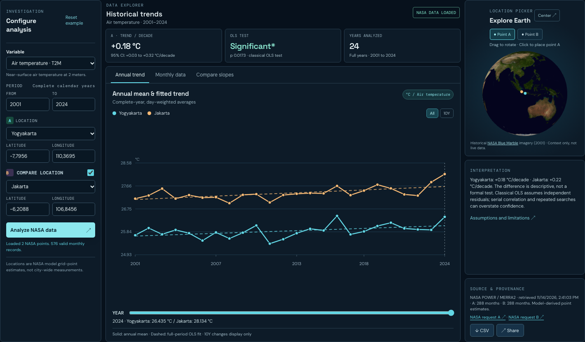
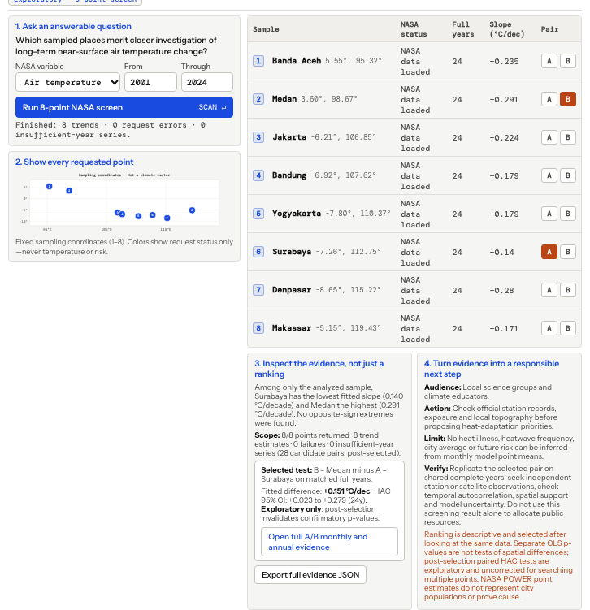

# Terra-Lens 🌍

**Follow the evidence.** An interactive Earth-system trend explorer for the **NASA Space Apps Challenge 2026**, responding to **[Be An Earth System Trend Detective!](https://www.spaceappschallenge.org/2026/challenges/earth-system-trend-detective/)**.

Terra-Lens lets users select an environmental variable, choose geographic points, inspect NASA monthly observations over time, estimate linear trends per decade, and understand the difference between an observed change and statistical evidence for a trend.

**The application uses real NASA POWER data. It does not silently generate, substitute, or claim AI-predicted observations as measured data.**


*Desktop workspace (`1440×900`, real Chromium capture against live NASA POWER `T2M` data) showing Point A Yogyakarta (`+0.18 °C/dec`), Point B Jakarta (`+0.22 °C/dec`), paired HAC contrast, interactive 3D Blue Marble coordinate picker, and provenance exports.*

## Capabilities

| NASA challenge question | Terra-Lens answer |
| --- | --- |
| What is changing? | Select NASA POWER 2 m temperature, relative humidity, or corrected precipitation rate. |
| Where? | Pick coordinates or compare two named point locations. |
| How much? | Estimate an ordinary-least-squares linear slope per decade and fitted change over the observed span. |
| When? | Plot monthly and complete-year historical time series. |
| Is it significant? | Report classical two-sided Student t-test p-value and 95% confidence interval, with limitations. |

The map-like coordinate graphic is **not** a spatial heat map. A NASA POWER grid-point sample is **not** an official city-level observation or a polygon average.

## Start immediately

Install the locked dependencies and start the Vite development server:

```bash
git clone https://github.com/Ni-zav/terra-lens.git
cd terra-lens
npm ci
npm run dev
# open the local URL printed by Vite
```

The default Yogyakarta/Jakarta investigation loads from NASA on entry. Select a variable, 10+ calendar years, and one or two locations, then press **Analyze NASA data** to request a new investigation. The application requests the NASA API through `/api/power` when a Cloudflare Pages Function is available, otherwise tries NASA POWER directly.

**Production hosting:** GitHub Pages deploys the built `dist/` directory through GitHub Actions. It calls NASA POWER directly. For Cloudflare Pages, use `npm ci && npm run build` and output directory `dist`; the repository also includes an optional Pages Function proxy, which must be tested on that host.

## Tests

```bash
npm run check
```

Node 20.19+ is required. The workspace uses React, Vite, Apache ECharts, and Three.js; exact versions are pinned in `package-lock.json`. The browser smoke test is separate; its deterministic fixture is only for tests and never used in the shipped app.

## Seven-slide project demonstration

The [NASA POWER case-study notebook](notebooks/nasa_power_case_study.ipynb) retrieves the two real series, reproduces the annual trends with SciPy, compares them with the application on the same responses, and generates the deck's scientific figures. Install `notebooks/requirements.txt` and run it from a local Jupyter session; NASA access and Node.js are required. Results can change if NASA revises its data.

- [Public browser-slide presentation](demo/index.html) — seven navigable slides; available as a working webpage after hosting the repository.
- [Seven-slide downloadable PDF](demo/Terra-Lens_Seven_Slide_Demo.pdf) — generated by GitHub Actions from the same slides with a real NASA browser screenshot.
- [Actual NASA browser screenshots and provenance](docs/screenshots/README.md) — captured against real NASA API data in Chromium, not synthetic fixtures.


*Exploratory 8-point Indonesian Trend Contrast Finder (`2001–2024` `T2M`) with explicit multiple-comparison and spatial-support disclosures.*
- [Live NASA browser validation workflow](.github/workflows/live-browser.yml) — tests two points, a second variable, CSV exports, and mobile layout.
- [Independent NASA/SciPy cross-validation](.github/workflows/scipy-verify.yml) — retrieves NASA observations and recomputes the same annual trends in Python and JavaScript.

**Live review preview:** https://ni-zav.github.io/terra-lens-preview/ (provenance recorded at https://ni-zav.github.io/terra-lens-preview/BUILD-PROVENANCE.txt). The earlier `main` deployment (`https://ni-zav.github.io/terra-lens/`) predates this review branch's Giovanni regional case.

## Project evidence

- [Verified NASA case study — Yogyakarta and Jakarta](docs/CASE_STUDY.md)
- [Mathematical method and interpretation](docs/METHODOLOGY.md)

## Scientific limitations

Annual values use day-weighted monthly means, retaining only years with all 12 valid months. The trend is simple OLS on annual means. The reported p-value and confidence interval assume independent, roughly homoskedastic residuals; autocorrelation, nonlinear behavior, reanalysis changes, and exploratory multiple comparisons can make significance claims unreliable. **A p-value is not a causal explanation or a statement about the future.** Detailed caveats appear in the methodology.

NASA POWER's meteorological parameters are derived from NASA GMAO **MERRA-2** assimilation/reanalysis. They are model-derived, not direct measurements at street level.

## Authorship and acknowledgments

Built during the 14–15 November 2026 hackathon window. AI-assisted research, code drafting, testing and submission preparation were used. This is disclosed for evaluation; scientific results are produced by deterministic code, not generative AI. There is no generative AI answering scientific questions or substituting observations in the running application.

Source attribution: [NASA Giovanni](https://giovanni.gsfc.nasa.gov/), [NASA POWER](https://power.larc.nasa.gov/), [NASA POWER monthly API](https://power.larc.nasa.gov/docs/services/api/temporal/monthly/), [NASA MERRA-2](https://gmao.gsfc.nasa.gov/reanalysis/MERRA-2/), [NASA Space Apps Challenge](https://www.spaceappschallenge.org/2026/challenges/earth-system-trend-detective/). The browser application and slide deck load `Instrument Sans` and `DM Mono` from Google Fonts with local system sans-serif and monospace fallbacks.

Independent hackathon project. Not affiliated with, sponsored by, or endorsed by NASA.

## License

MIT; see [LICENSE](LICENSE).

### Geographic picker and chart inspection

The interactive globe is a location picker, not a live raster or trend map. Its
background is the Blue Marble 2001 land and shallow-water composite, courtesy
Reto Stöckli and NASA Earth Observatory. The image is downsampled and compressed
from the [NASA image](https://science.nasa.gov/earth/earth-observatory/the-blue-marble-true-color-global-imagery-at-1km-resolution/).
NASA POWER results are retrieved separately for the selected coordinates. For
precise or keyboard-only selection, use the latitude and longitude fields. Drag
the globe to rotate; click to set point A or B. The globe is loaded only when
it approaches the viewport, and the form remains usable if WebGL is unavailable.

Annual and monthly charts provide a date slider and a crosshair. Values shown
are actual records at that date; missing records are labeled rather than filled
or interpolated. The optional last-ten-years view changes only the display;
trend statistics continue to use the full requested analysis period. Sliders and
the scrollable plot regions are keyboard accessible.
Three.js 0.187.0 is distributed under the MIT license in `vendor/THREE-LICENSE.txt`.


## Evidence workflows in main

This branch introduces a paired A/B trend comparison using **shared complete calendar years**, a direct B−A slope, and an exploratory **Bartlett Newey–West HAC** uncertainty estimate. It does not confuse separate individual t-tests with a test of their difference. Download an auditable Evidence JSON alongside the existing original monthly CSV.

The NASA POWER selector includes nine meteorological parameters rather than three, with explicit units and meanings; see [data catalog](docs/DATA_CATALOG.md). A local **NASA Giovanni monthly CSV** workspace can analyze a second source with product ID, DOI, original URL, file checksum, complete-year means and classical OLS; see [Giovanni evidence guide](docs/GIOVANNI_EVIDENCE.md).

**Release caution:** The branch analyzes a [Giovanni regional MERRA-2 series](docs/NASA_QUALIFYING_SOURCE_HANDOFF.md), with the original output, source links, checksums and independent verification. The Giovanni output has no quality-flag variable, and its input-granule quality was not independently audited. NASA determines award eligibility; neither this work nor a GitHub PR constitutes an official submission. The separate [NASA tutorial table](docs/GIOVANNI_TUTORIAL_CASE.md) has incomplete job lineage and is labeled accordingly.


## Multi-source NASA context & regional sentinel screening

In addition to the 4-point (A/B/C/D) NASA POWER workspace, Terra-Lens connects two verified multi-source NASA case studies in the **Multi-source** tab (`#tab-cases`, `src/react/ScienceCases.jsx`) alongside the 8-point **Contrast Finder** (`#tab-finder`, `src/react/ContrastFinder.jsx`):

1. **River Satellite vs. Modeled Rain (`SWOT + POWER`):** Compares 12 irregular passes from **NASA PO.DAAC SWOT Level-2 River Single-Pass Vector Product vD** on Ohio River SWORD Reach `74267300251` (`Mar–May 2025`, water-surface elevation `120.68–131.25 m` above geoid, `10` quality-1 suspect and `2` quality-2 degraded passes) against monthly **NASA POWER `PRECTOTCORR`** (`mm/day`) at the nearby Louisville grid cell (`38.2527°, -85.7585°`). Separate panels preserve the distinct physical units, irregular satellite cadence, and 3-month overlap without claiming a flood gauge or correlation test.
2. **Local Grid vs. Global Index (`POWER + GISS GISTEMP v4`):** Places Yogyakarta's 2001–2024 NASA POWER `T2M` series (`+0.1791 °C/decade`, `p = 0.0173`) alongside the **NASA GISS Surface Temperature Analysis (`GISTEMP v4`, `GLB.Ts+dSST`)** global land-ocean anomaly index (`+0.2504 °C/decade`, `p = 2.75e-8`, dated official table excerpt `2026-11-14`), both rebased to `2001–2020` calendar-month normals for visual alignment without claiming a point-vs-globe significance test. Users can also re-verify the comparison against the live NASA POWER API directly in the browser.
3. **8-Point Indonesian Sentinel Contrast Finder:** Screens a predeclared 8-coordinate Indonesian frame (`2001–2024` `T2M`), ranking fitted slopes from Surabaya (`+0.140 °C/decade`) to Medan (`+0.291 °C/decade`) and reporting the post-selected paired HAC interval as exploratory only. See [discovery limitations](docs/DISCOVERY_METHOD.md) and [verified sentinel case study](docs/DISCOVERY_CASE_STUDY.md).
4. **Source Catalog Transparency:** Planned connectors (`GPM IMERG`, `GLDAS`, `MODIS MOD11C3`, `FIRMS`) are explicitly marked `planned` in the UI catalog table so planned roadmap items are never confused with active browser integrations.

The official challenge Resources tab lists Giovanni, Hydrology Time Series, and AppEEARS as NASA resources. The branch uses actual Giovanni output; see [provenance and eligibility](docs/NASA_RESOURCES_PROVENANCE.md).

## Final source-eligibility and release checks (15 November 2026)

The selected challenge's official **NASA Data & Resources** section lists
[Giovanni](https://giovanni.gsfc.nasa.gov/giovanni/),
[Hydrology Time Series](https://disc.gsfc.nasa.gov/information/tools?title=Hydrology%20Time%20Series),
and [AppEEARS](https://appeears.earthdatacloud.nasa.gov/).
The existing NASA POWER, SWOT and GISS analyses are real scientific examples,
but do not by themselves demonstrate use of a listed NASA source. The branch now
also analyzes an authenticated Giovanni MERRA-2 area-average export. The original
CSV and NetCDF, job URLs, product DOI, missing-value handling and independent
SciPy cross-check are recorded in [the source handoff](docs/NASA_QUALIFYING_SOURCE_HANDOFF.md).
No quality-flag variable is present in the output; input-granule QA and model
uncertainty remain limitations. NASA determines Global Award eligibility.
See [source-evidence requirements](docs/NASA_RESOURCES_PROVENANCE.md).

For an Earthdata-authorized participant, the new
[secure Giovanni acquisition guide](docs/GIOVANNI_AUTHENTIC_SOURCE_GATE.md)
and `scripts/fetch-authentic-giovanni.mjs` can request an original NASA monthly
point time series, preserve original CSV bytes **outside Git**, calculate
SHA-256, and generate evidence for independent SciPy validation. A configured
downloader, importer, or test fixture is not evidence of a successful NASA
download. Never commit NASA login credentials or tokens.

For another region, the Giovanni tab builds an area-average query for the same
validated monthly T2M product using user-selected bounds and years. Giovanni
runs the query on NASA's site; its classic CSV can be imported locally. POWER
point requests already support global coordinates and nine listed variables.
Other products, automatic Giovanni API access and cross-source causal inference
remain planned, not implemented capabilities.
The eight-point finder uses a 15-minute in-memory cache for successful POWER
requests and records cache hits and original retrieval time. The main workspace
does not currently cache requests; this is not an archive download or an
offline-data promise.

To run the logged-out public production acceptance audit (which tests
**deployed main, not the current unmerged branch**):

```bash
npm ci
npx playwright install chromium
node scripts/hosted-acceptance.mjs
```

The audit covers a real NASA POWER default investigation, CSV export, core
data-source tabs, mobile overflow, linked presentation/PDF, and a clearly
labeled simulated NASA transport failure (no invented fallback data). See the
[read-only workflow](.github/workflows/hosted-acceptance.yml).

**No NASA account submission occurs from these scripts.** The official
challenge source gate, presentation approval and actual NASA Team Project
submission require separate human review.
